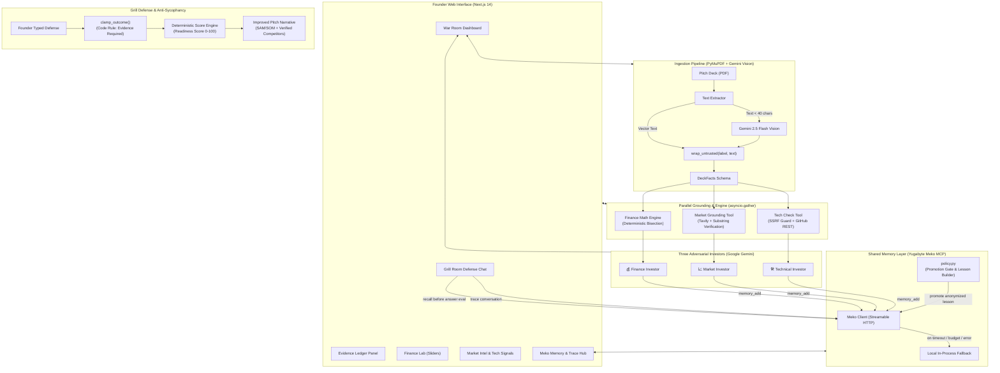

# SecondBrain Architecture

## System Diagram (Gemini + Yugabyte Meko)

## Core Architectural Guarantees
1. **Deterministic Numbers:** No LLM estimates financial metrics or scores. Math is 100% Python.
2. **Anti-Hallucination:** Every competitor quote and funding figure is verified as a verbatim substring in code against the fetched web page.
3. **Data Privacy & Policy Gating:** No company names, founder PII, or deck numbers are ever promoted into global Meko Shared Knowledge.
4. **Resilience:** Automatic fallback to `LocalMemoryClient` on network timeout, call budget exhaustion, or cached offline demo mode.
